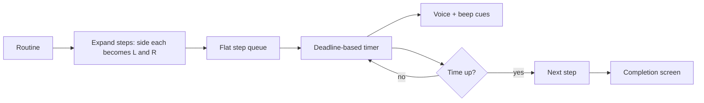

# Bend Lite — MVP & Development Stages

## Scrape feasibility — verified, no browser needed

Tested with plain `curl` + `urllib` from WSL2 against 6 routine pages and the image CDN. **A headless browser is not required for anything.** Evidence:


| Question                                            | Answer                                                                                                                                                                                                       |
| --------------------------------------------------- | ------------------------------------------------------------------------------------------------------------------------------------------------------------------------------------------------------------ |
| Is exercise text in static HTML?                    | Yes — instructions, tips, modifications, body areas all present in the `curl` response                                                                                                                       |
| Are images fetchable over plain HTTP?               | Yes — HTTP 200, no auth, no referer or cookie check                                                                                                                                                          |
| Is the routine index static?                        | Yes — all **100 slugs** in raw HTML of `bend.com/routines`                                                                                                                                                   |
| Anything only in the RSC payload or client-fetched? | No — the `self.__next_f` flight payload holds pre-rendered JSX, not extra data. Probes for `"instructions"`, `"bodyAreas"`, `imageUrl` etc. all returned 0 matches, so there is no hidden JSON API to prefer |
| Per-exercise durations?                             | **Yes** — see below, this was the big surprise                                                                                                                                                               |


Because plain HTTP returns everything, Playwright/Selenium would add a ~400 MB browser download, a `sudo npx playwright install --with-deps chromium` step for system libs, and headless-on-WSL2 complexity for zero benefit. Not in the plan; only revisit if Bend later moves this content behind client-side rendering.

### Verified asset facts

- **Illustrations:** `https://api.bend.com/static/exercise_images/image_%05d.png`. Mostly **350x350 PNG at ~3.5-6 KB**, but not uniform — `image_00120` is 300x300. Render in an aspect-square container with `object-contain`; do not hardcode 350. Static stills only; the animations in the native app aren't exposed on the web.
- **Library is bounded and small.** Binary-searched the id space: `image_00000` through `**image_00225` exist, 226+ is 404** → about **226 total exercises, roughly 1 MB of images**. Trivial to commit to the repo.
- **Metadata per exercise** (exactly what you asked for) comes from `bend.com/routines/<slug>`, structure `article > header > figure > img` + `h3`, then one `section` per block with an `h4` label. Labels observed: `Instructions`, `Tips`, `Modifications`, `Benefits`.
  - `Benefits` is **not prose** — it's the comma-separated muscle-group / body-area list (`"Abdomen, Chest, Lats, Obliques, Shoulders, Spine, Upper Back"`). Split on `", "` and store as `bodyAreas`, which then powers filtering for free.
  - **Sections are optional**: `Lizard Pose` has no `Modifications` on any page it appears. Schema must tolerate missing blocks rather than assuming all four.
- **Per-exercise durations ARE available**, in the `Exercise Overview` block above the instructions. Values seen: `0:15`, `0:30`, `1:00`, `2:00` — confirming Bend's rigid 15/30-second granularity that you want to escape. Overview row count matched exercise count exactly on all 6 pages tested (8, 9, 8, 6, 24, 6), so the two lists can be zipped positionally.

### Parser gotchas found by probing

- **Filter the articles.** A routine page has far more `<article>` elements than exercises (wake-up: 24 articles, 8 exercises; pelvic-floor-3: 40 articles, 24 exercises). The extras are "similar routines" link cards, which reuse exercise images and would silently pollute the library. Reliable discriminator: **keep only articles containing an `h4` of `Instructions`**. This gave an exact match to the overview row count on every page.
- **Exercises repeat within a routine.** `wake-up` opens and closes with `Upward Salute` (both `image_00000`). Routine composition must be an ordered list that allows duplicates — never a set or a map keyed by exercise id.
- **Strip the leading index** from headings (`"1. Upward Salute"` → `"Upward Salute"`).
- Image ids come from the `srcSet`, which is URL-encoded through Next.js's optimizer; unquote before matching `image_\d+\.png`.

### Per-side detection: heuristic, needs a review pass

Bend's web pages carry no explicit left/right field. Two inferable signals, tested across 5 routines:

1. **Instruction language** (`"one leg"`, `"opposite"`, `"other side"`, `"front knee"`, `"right ear"`) — caught the obvious unilateral moves (Lizard Pose, Pigeon, Side Lunge, Reverse Lunge, Hurdler, Lunge, Neck Rotation).
2. **Duration doubling** — within a routine, unilateral exercises consistently ran 2x the bilateral ones (hips: 2:00 unilateral vs 1:00 bilateral), implying Bend's listed duration is the total across both sides. So an imported 2:00 unilateral means **1:00 per side**.

Accuracy is roughly 85%, with real errors in both directions: false positives on `Hand Plank` ("place one foot...") and `Rag Doll` ("opposite elbows"), false negatives on `Hand Side Plank` / `Elbow Side Plank` which are obviously per-side. **Treat the heuristic as a suggestion written into the generated data, then do one manual review pass** over ~226 exercises and keep a hand-maintained override list. Don't trust it blind.

## Environment — all work happens inside WSL2

Verified: Ubuntu 22.04.5 LTS on WSL2, node v22.17.1, npm 10.9.2, pnpm 10.13.1, git 2.34.1, python 3.10.12, curl 7.81.0. Headless, no display server.

- **Project path: `/home/dchen327/coding/projects/bend-lite`** (the parent dir exists and already holds ~30 projects). The repo lives on the **Linux filesystem, never `/mnt/c`** — cross-OS filesystem access makes `node_modules` I/O and Next.js dev-server rebuilds drastically slower.
- Call `**move_agent_to_root` on `/home/dchen327/coding/projects/bend-lite**` as soon as the directory exists, before any scaffolding or installs.
- **node is installed via nvm, so it only exists on an interactive shell's PATH.** `wsl.exe -e bash -lc "node -v"` fails with `command not found`; `wsl.exe -e bash -ic "node -v"` works. **Use `bash -ic` for every node/npm/pnpm/npx command** (or `source ~/.nvm/nvm.sh` first). System binaries like `curl`, `git`, and `python3` work fine under either.
- `**$HOME` is mangled** — WSL inherits the Windows `USERPROFILE`, so `$HOME` reports `C:Usersdavid` even under `bash -ic`. Never rely on `~` or `$HOME`; always pass absolute Linux paths or `cd` explicitly first.
- **The distro stops when idle and `/tmp` is wiped** between invocations (hit this mid-research). Put the scraper's HTML cache in the project dir (`.cache/`, gitignored), not `/tmp`.
- Quoting through PowerShell → `wsl.exe` → bash → python is very fragile. Put multi-line logic in a **script file** and execute it, rather than inlining `python3 -c "..."`.
- **Watch file encoding:** files written to Windows paths by the agent's editing tools landed as **UTF-16LE**, which python refused to parse (`SyntaxError: unterminated string literal`). Create project files directly on the Linux side and sanity-check with `file`/`head` if anything mis-parses.

## Stack

- Next.js (App Router) + TypeScript + Tailwind + shadcn/ui, deployed on Vercel
- No database. All user state in `localStorage` behind a small typed wrapper
- Exercise data as a generated static TS module; images in `public/exercises/`
- Audio: Web Speech API for voice cues + WebAudio oscillator beeps (zero audio assets)
- Scraper: plain `fetch` (node 22 has it built in) + `cheerio` for parsing. No Playwright, no Selenium.
- PWA deferred to a later stage

## Data model (MVP-minimal)

```ts
type Exercise = {
  id: string;              // "childs-pose", slugified from name
  name: string;
  image: string;           // "/exercises/image_00000.png"
  instructions: string[];  // always present (it's the parser's discriminator)
  tips?: string[];         // optional - some exercises omit blocks
  modifications?: string[];
  bodyAreas: string[];     // from the "Benefits" block, split on ", "
  sideSuggested: boolean;  // heuristic output, hand-reviewed; not authoritative
};

type RoutineStep = {
  exerciseId: string;
  duration: number;        // seconds, ANY integer - the whole point
  side: "both" | "each";   // "each" expands into two player steps
};

// Ordered list, duplicates allowed (wake-up uses Upward Salute twice)
type Routine = { id: string; name: string; steps: RoutineStep[] };

// Scraped composition of Bend's own routines, used as importable presets
type BendRoutine = {
  slug: string;            // "wake-up"
  name: string;
  description: string;
  steps: { exerciseId: string; bendDuration: number }[]; // seconds, from Exercise Overview
};
```

For a `BendRoutine` step where the exercise is unilateral, `bendDuration` is the total across both sides, so importing it should produce `duration: bendDuration / 2, side: "each"`.

## Player flow




## Technical details that matter

- **Timer accuracy:** store an absolute `deadline = performance.now() + ms` and drive the UI from `requestAnimationFrame`, never accumulate `setInterval` ticks. Browsers throttle background timers; deadline math survives it.
- **Screen wake lock:** `navigator.wakeLock.request("screen")` on start, re-acquire on `visibilitychange`. Without this the phone sleeps mid-routine and hands-free operation breaks.
- **iOS audio unlock:** both `speechSynthesis` and `AudioContext` must be primed inside the Start button's click handler (speak an empty utterance, `audioCtx.resume()`), or nothing plays on iPhone.
- **Cue schedule per step:** speak exercise name + side at start, beep at 3/2/1, distinct chime at transition.

---

# Stages

## Stage 0 — Project + full library scrape

Create `/home/dchen327/coding/projects/bend-lite` (git init), call `move_agent_to_root` on it, scaffold Next.js + TS + Tailwind + shadcn with `pnpm` under `bash -ic`, then write a one-off script `scripts/scrape.ts` (plain `fetch` + `cheerio`):

1. Fetch `https://bend.com/routines`, extract every `/routines/<slug>` href, drop the junk `page-<hash>` entry → 100 slugs.
2. Fetch all 100 routine pages with concurrency ~4 and a small delay, caching raw HTML to `.cache/` (gitignored) so parser iteration never re-hits the site.
3. Per page, keep only `<article>` elements containing an `h4` of `Instructions`, then assert the count equals the `Exercise Overview` row count — **fail loudly on mismatch**, since that invariant held on all 6 pages tested and is the signal that their markup changed.
4. Parse each into an `Exercise`: name (index stripped), image id (URL-decoded from `srcSet`), instructions, optional tips/modifications, `bodyAreas` split from the Benefits block, plus the `sideSuggested` heuristic. Dedupe by image id across routines.
5. Zip overview durations positionally onto the routine's ordered steps to build each `BendRoutine`.
6. Download each unique PNG to `public/exercises/image_XXXXX.png`, skipping existing files. Expect ~226 files, ~1 MB.
7. Emit `src/data/exercises.ts` (id-keyed map) and `src/data/bendRoutines.ts`.
8. Report coverage: unique image ids found vs. the known `image_00000`-`image_00225` range. Any gap means those exercises never appear in a public routine and have no scrapeable metadata — log them rather than silently missing them.

Exercise ids are slugified names (`Child's Pose` → `childs-pose`) with a collision check that throws instead of silently overwriting.

Committed output is fully static — the scraper never runs at build or request time, and the app has zero runtime dependency on Bend.

Then a **one-time manual review pass** on `sideSuggested` (see the heuristic caveats above), recorded as an explicit override list in the repo so re-running the scraper can't clobber it.

Getting the whole library now means Stage 3 is pure UI work and Stage 1 can pick exercises from real data instead of hand-typed stubs.

## Stage 1 — MVP: hardcoded routine + player

The only stage needed to make the app usable daily.

- `src/data/routines.ts` with your one routine. Since Stage 0 captures Bend's own per-exercise durations, this can be seeded by importing the matching `BendRoutine` and then overriding the timings, rather than typed from scratch.
- `/` — routine name, step list with durations, total time, big Start button
- `/play` — full-screen player: illustration, name, side badge, big countdown, thin progress bar, collapsed instructions, pause/skip/prev
- Voice + beep cues, wake lock, completion screen
- Deploy to Vercel, add to iPhone home screen

## Stage 2 — Editable durations (the actual reason for building this)

- Duration editor on the routine screen: free-form seconds input per step, no 15s increments
- Reorder (drag) and remove steps
- Persist the edited routine to `localStorage`, with "reset to default"
- Global settings: transition/rest seconds, voice on/off, beeps on/off, countdown lead time

## Stage 3 — Library browser + multiple routines

Data already exists from Stage 0, so this is UI only.

- `/exercises` — browse all ~226 exercises, searchable, filterable by body area (the `bodyAreas` field is already a clean muscle-group list, so the filter set can be derived from the data rather than hand-maintained)
- Exercise detail sheet with instructions, tips, modifications, and body areas
- Browse Bend's 100 routines as presets: pick one, it becomes an editable local routine pre-filled with Bend's real durations (halved and marked per-side where unilateral), which you then tune freely
- Create/duplicate/delete routines, all in `localStorage`

## Stage 4 — Progress and streaks

- Log a `Session` on completion (`localStorage`): routine id, start, end, completed steps
- `/progress` — current streak, longest streak, calendar heatmap, weekly minutes
- JSON export/import (your only backup, since there's no database)

## Stage 5 — PWA and reminders

- `manifest.json`, icons, offline caching of images and app shell (`next-pwa` or a hand-rolled service worker)
- Reminders: only reliable via Web Push + a server component, so realistically an iOS Shortcut/calendar alarm that deep-links into `/play` is the pragmatic option here

## Optional later

- AI routine generation (an API route calling a model with the library as context)
- Adaptive programming based on session history

---

## Input needed from you before Stage 1

Just the name of the Bend routine your phone routine is based on (or the exercise list if it's fully custom). Durations are now scrapeable, so we can seed from Bend's numbers and you adjust from there — no need to transcribe timings by hand.

## Notes

- The scraped illustrations and text are Bend's copyrighted content. Fine for a personal, non-distributed app; do not publish it publicly or share the deployment. The crawl is one-off, concurrency-limited, and cached, so it's a light touch on their servers.
- Nothing has been scraped yet. All findings above came from ~15 read-only probe requests (6 routine pages, the routines index, and a handful of image HEAD/GET checks).

